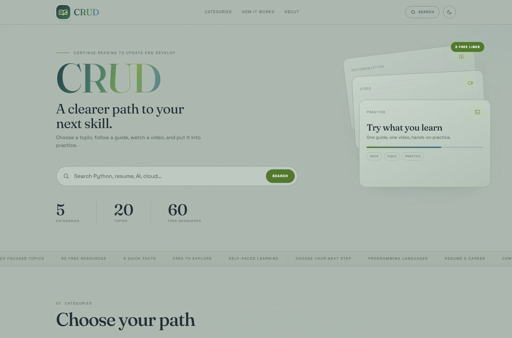
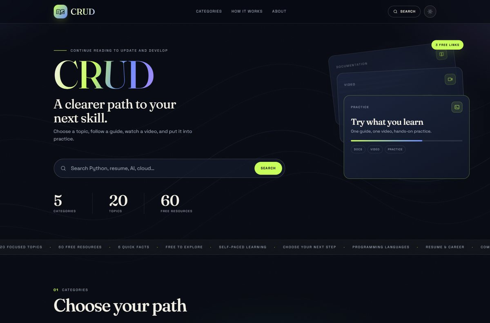

# CRUD — Continue Reading to Update and Develop

**A curated learning atlas for developers.** 5 categories, 20 focused topics, 60 free resources.
Every topic gives you exactly three links: one guide to read, one video to watch, one place to practise.

**[Live site →](https://crud-learning-platform.vercel.app)**

---

## Why this exists

Learning to code usually starts with a search engine and ends with forty open tabs. Every list you find online throws fifty links at you with no order, no priority and no "start here" — so most people close the tab and learn nothing.

CRUD removes that decision. Each topic is limited to **three resources**, and each one has a job:

- **Read** — the official documentation or the best written guide
- **Watch** — the single best free video course on that topic
- **Practise** — an interactive exercise, playground or hands-on project

No account, no paywall, no sign-up, no tracking. Open a topic, pick one link, start learning.

---

## Preview

| Light | Dark |
|:---:|:---:|
|  |  |

The site opens in **light** mode on a first visit, then remembers whichever theme you chose.

---

## What's inside

| # | Category | Topics | Resources |
|:-:|---|:-:|:-:|
| 01 | Programming Languages — Python, JavaScript, Java, C++, C#, SQL, Django, Web Foundations | 8 | 24 |
| 02 | Resume & Career — templates, ATS, interviews, LinkedIn | 4 | 12 |
| 03 | Companies & Careers — company pages, salary data, interview experiences | 4 | 12 |
| 04 | Emerging Tech — AI, cloud, cybersecurity, data | 4 | 12 |
| 05 | Facts & Insights — six quick facts about software and the industry | — | 6 cards |
| | **Total** | **20** | **60** |

---

## Features

- **Light and dark themes** — one click, saved for the next visit
- **Category cards** that tilt and glow toward the cursor on desktop, and respond to press with a finger-following spotlight on touch screens
- **Instant search** across topics, providers and resources
- **Shareable links** — `#/c/programming`, `#/t/python`, `#/search?q=sql`
- **Responsive** from 360 px phones to wide desktops
- **Keyboard accessible** — skip link, visible focus rings, ARIA labels
- **Motion-aware** — every animation respects `prefers-reduced-motion`
- **No tracking, no cookies, no backend**

---

## Tech

One self-contained `index.html` containing the markup, styles, logic and content.
No framework, no build step, no npm, no database. The only external request is Google Fonts.

```text
index.html      the entire website
assets/         README preview images
vercel.json     clean URLs + security headers
robots.txt      allows search engines to index the site
```

---

## Run locally

```powershell
python -m http.server 5173
# open http://localhost:5173
```

Or simply double-click `index.html`.

---

## Deploy

Hosted on **Vercel** with zero configuration: Framework preset **Other**, no build command, no output directory.

---

## Licence

It's a free learning project. Resource links belong to their respective owners.
